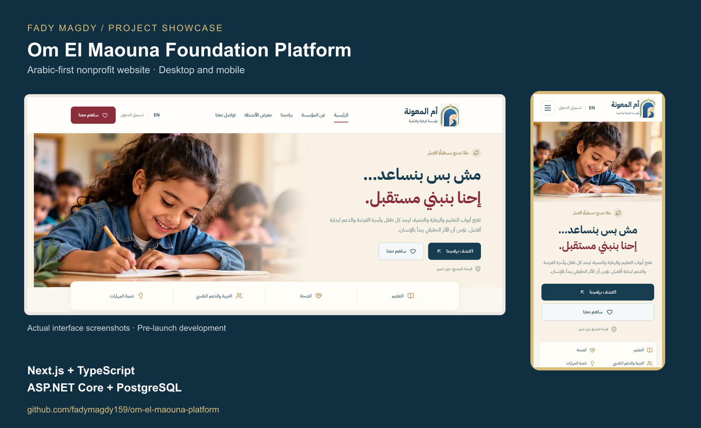

# Om El Maouna Foundation Platform

An Arabic-first, bilingual website for a nonprofit supporting education, health, personal development and skills. Built with **Next.js, TypeScript, ASP.NET Core and PostgreSQL**, with responsive public pages, member accounts and a dedicated administration workspace.



**Status: pre-launch development.** This repository is a sanitized source snapshot. It contains no production database, member records, local credentials, email previews or original beneficiary photographs. The foundation's operational site has not been publicly deployed through this repository.

## Features

- Arabic / English navigation and content, with RTL / LTR layouts and mobile support.
- Registration, email confirmation, password recovery and member profiles.
- A single administrator account protected by authenticator-based two-factor verification.
- Bilingual programs with draft, publish, archive and restore workflows.
- Volunteer applications, parent / child enrollment and financial or in-kind contribution coordination requests.
- Member request tracking and administrator review, replies and status updates.
- Image and video management, metadata, publication controls and a keyboard-accessible gallery.
- Editable site and contact content, audit records and concurrent-edit protection.
- Persistent contact messages and a transactional email outbox with SMTP support and retries.

Contribution requests coordinate support; **online payment processing is not implemented**. External email delivery requires SMTP configuration. Local development uses email previews.

## Technology

| Layer | Technology |
| --- | --- |
| Web | Next.js App Router, React, TypeScript, Tailwind CSS |
| API | ASP.NET Core, ASP.NET Core Identity, Entity Framework Core |
| Storage | PostgreSQL, Npgsql, filesystem media storage |
| Media | SkiaSharp, FFmpeg integration |
| Email | MailKit, persistent outbox |
| Tests | xUnit API integration tests, Playwright browser tests |

## Structure

```text
apps/api/       API endpoints, Identity, persistence and EF migrations
apps/web/       Bilingual public website, member area and administration
tests/api/      API rules and integration coverage
scripts/        Windows local-development helpers
```

The web application calls the API through a same-origin web proxy. PostgreSQL stores identities, content, requests, audit records and email jobs. Media is served according to publication state; unpublished uploads require authorized access.

## Local development on Windows

Install the .NET SDK specified in `global.json`, Node.js 24, PostgreSQL 16 command-line tools and FFmpeg (for video processing). The helper scripts expect the local tool layout configured in `scripts/environment.ps1`; adapt that file to your installation. Do not commit machine-specific configuration or generated credentials.

```powershell
.\scripts\initialize-development.ps1
# In two separate PowerShell terminals:
.\scripts\start-api.ps1
.\scripts\start-web.ps1
```

The initializer creates an isolated local database, applies migrations, provisions a local administrator and seeds four development programs. Administrator credentials are generated locally and protected using Windows DPAPI. Use `scripts/show-development-login.ps1` locally to retrieve them, then complete authenticator enrollment. Never share the output.

Open `http://127.0.0.1:3000/ar` or `/en`. Upload your own authorized images through the administration dashboard. Original media imports and tests tied to private institutional media are intentionally excluded from this public snapshot. Empty media sections are expected until uploads are added.

## Verification

```powershell
.\scripts\test.ps1
cd apps/web
npm run lint
npm run typecheck
npm run build
```

API integration tests use a separate test database. Browser tests require a running web/API environment; review each fixture's setup requirements before running. The private development environment has been checked with API integration tests and desktop/mobile browser scenarios. This sanitized snapshot still requires fresh-environment validation and is not represented as production ready.

## Security and publication boundaries

- Credentials, local databases, uploaded files, email previews and build output are ignored by Git.
- Test-only credentials in isolated automated fixtures are disposable examples, not operational accounts.
- Public contact defaults are placeholders; configure approved details through administration.
- Included mockup and story artwork is illustrative; it is not evidence of real beneficiaries or impact statistics.
- Production work remains: hosting, HTTPS, SMTP, backups and restore drills, monitoring, configuration review and final content approval.

## Author

**Fady Magdy** · [GitHub](https://github.com/fadymagdy159) · [LinkedIn](https://www.linkedin.com/in/fady-ibrahim159/)

Developed as a practical full-stack project with AI-assisted implementation and review. No open-source license is granted by this repository; foundation branding and media rights remain with their respective owners.
